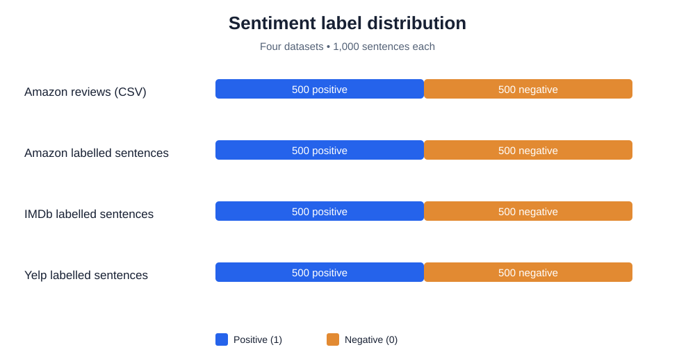
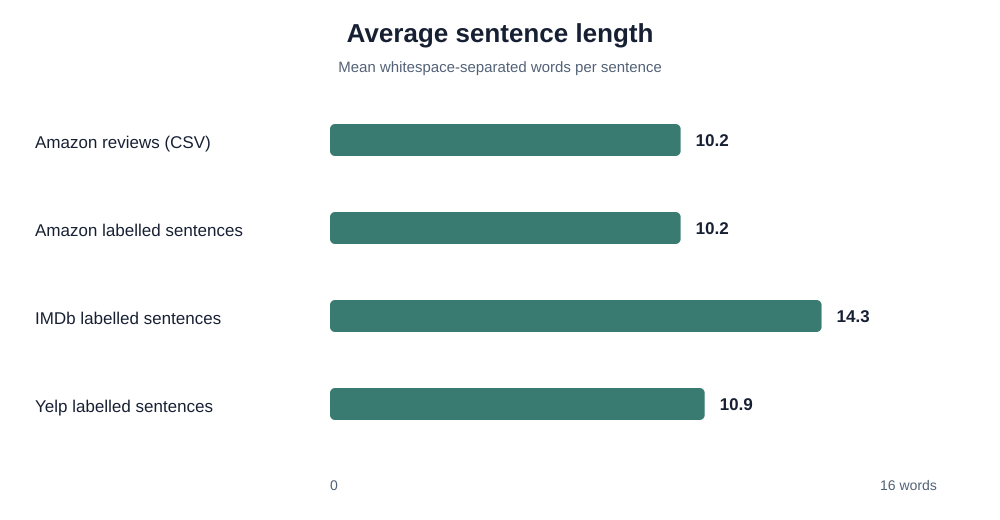

# Visual Results

This folder contains descriptive visualizations generated directly from the four sentiment datasets in `data/`. These are dataset-exploration results, not model-performance results.

## 1. Sentiment label distribution

All four datasets contain 1,000 labelled sentences: 500 positive (label 1) and 500 negative (label 0). The classes are perfectly balanced in these source files.

## 2. Average sentence length

Average length is calculated as the mean number of whitespace-separated words per sentence. IMDb has the longest average sentence length (14.3 words), while the Amazon datasets average 10.2 words and Yelp averages 10.9 words.

## Reproducibility and interpretation

- Source files: `data/amazon-reviews/Amazon.csv` and the three files in `data/sentiment-labelled-sentences/`.
- Labels: `1 = positive`, `0 = negative`.
- Sentence length is a simple descriptive measure; punctuation and tokenization are not normalized.
- No classifier was trained for these charts, so they do not show accuracy, precision, recall, F1-score, or other predictive performance metrics.
